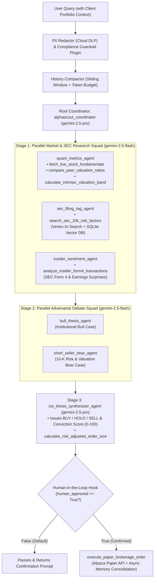

# AlphaScout: Autonomous Equity Research, SEC Filing Analyst & Paper Brokerage Agent

**AlphaScout** is an institutional-grade multi-agent financial research and paper-execution system built with the **Google Agent Development Kit (ADK-Python)** and **Vertex AI (`gemini-2.5-pro` & `gemini-2.5-flash`)**.

It automates the end-to-end equity research desk workflow: pulling live stock fundamentals (`yfinance`), retrieving grounded risk factors from **SEC Form 10-K/10-Q** filings (**Vertex AI Search** + Persistent Vector Store), analyzing **SEC Form 4** executive insider transactions, staging an adversarial **Bull vs. Bear debate**, computing deterministic intrinsic valuation bands, and—upon explicit **Human-in-the-Loop (HITL)** confirmation—executing risk-sized paper orders via the **Alpaca Paper Brokerage API**.

---

## Why an Agent (Not Just a Standalone LLM Prompt)?

| Capability | Standalone Gemini Prompt | **AlphaScout ADK Multi-Agent System** |
| :--- | :--- | :--- |
| **1. Live Market & SEC Filing Grounding** | Relies on static training weights or generic web snippets; prone to hallucinating P/E ratios or share prices. | Executes deterministic Python tools against **live `yfinance` APIs**, **Vertex AI Search**, and **SEC Form 10-K / Form 4** data. |
| **2. Private Portfolio Context** | Has zero knowledge of your brokerage cash balance, existing holdings, or risk-per-trade limits. | Queries your persistent portfolio ledger to size exact share counts against live buying power and stock volatility (`Beta`). |
| **3. Deterministic Financial Math** | LLMs frequently miscalculate multi-year DCF/EPS compounding and position-sizing math. | Uses dedicated valuation and risk-sizing tools (`calculate_intrinsic_valuation_band`, `calculate_risk_adjusted_order_size`) validated by strict **Pydantic schemas**. |
| **4. Enterprise Compliance & PII Security** | Sensitive client account numbers, SSNs, or emails go straight into logs and history unredacted. | Scrubs all PII via **Google Cloud DLP (`google.cloud.dlp_v2`)** + regex filters before logging or storing in memory, and blocks MNPI/manipulation queries. |
| **5. Closed-Loop Action with Human Gate** | Can only generate text; cannot execute external brokerage transactions. | Halts at an ADK **`before_tool_callback` Human-in-the-Loop hook** for user approval, then submits a live order to **Alpaca Paper Brokerage** (`POST /v2/orders`). |

---

## Multi-Agent Architecture



---

## Key Engineering Capabilities

| Domain | Capability | Implementation Architecture |
| :--- | :--- | :--- |
| **Tool & Interface Design** | **Comprehensive Tool Specifications** | Complete Google-style docstrings (`Args:`, `Returns:`) across all 7 domain tools in [`alphascout/tools/`](alphascout/tools/). |
| | **Explicit Action Naming** | Unambiguous tool verbs (`fetch_live_stock_fundamentals`, `compare_peer_valuation_ratios`, `search_sec_10k_risk_factors`, `analyze_insider_form4_transactions`, `calculate_intrinsic_valuation_band`, `calculate_risk_adjusted_order_size`, `execute_paper_brokerage_order`). |
| | **Strict Schema Contracts** | Validated Pydantic v2 `BaseModel` schemas (`extra="forbid"`, regex & numeric bounds) in [`alphascout/schemas.py`](alphascout/schemas.py). |
| | **Guided Error Recovery** | Every tool intercepts invalid inputs and delisted/renamed tickers (e.g., `TWTR`, `FB`) and returns a structured `GuidedErrorResponse` with actionable `recovery_instructions`. |
| **Context & Memory** | **Structured Agent Constitutions** | Explicit `<CONSTITUTION>`, `<PERSONA>`, `<DOMAIN_KNOWLEDGE>`, and `<OPERATIONAL_CONSTRAINTS>` prompts in [`alphascout/prompts.py`](alphascout/prompts.py). |
| | **Conversational History Compaction** | `ContextCompactor` in [`alphascout/memory/session_store.py`](alphascout/memory/session_store.py) provides token estimation, sliding-window truncation, and turn summarization. |
| | **Hybrid Persistent Storage** | `VertexSearchAndVectorStore` in [`alphascout/memory/session_store.py`](alphascout/memory/session_store.py) connects to **Vertex AI Search (`discoveryengine_v1`)** and a persistent SQLite vector database (`sec_filing_vectors`, `session_memories`). |
| | **Non-Blocking Memory Consolidation** | `AsyncMemoryConsolidator` in [`alphascout/memory/session_store.py`](alphascout/memory/session_store.py) uses `asyncio.create_task()` and `asyncio.to_thread()` for background memory persistence. |
| **Orchestration & Safety** | **Multi-Agent Hierarchy** | Built with ADK `LlmAgent`, `ParallelAgent`, and `SequentialAgent` in [`alphascout/agent.py`](alphascout/agent.py) (`parallel_market_research_squad` $\rightarrow$ `adversarial_debate_squad` $\rightarrow$ `cio_thesis_synthesizer_agent`). |
| | **Complexity-Based Model Routing** | `route_model_by_task_complexity()` in [`alphascout/config.py`](alphascout/config.py) assigns high-speed extraction/debate to `gemini-2.5-flash` and CIO thesis synthesis/coordination to `gemini-2.5-pro`. |
| | **Compliance & Grounding Guardrails** | `FinancialComplianceGuardrailPlugin` in [`alphascout/callbacks/guardrails_and_hitl.py`](alphascout/callbacks/guardrails_and_hitl.py) (`before_model_guardrail_callback`, `after_model_self_eval_callback`) blocks MNPI/manipulation requests and verifies numerical grounding. |
| | **Human-in-the-Loop Execution Gate** | `before_tool_hitl_and_intent_callback` and `execute_paper_brokerage_order` enforce a hard execution stop (`status="pending_human_confirmation"`) unless `human_approved=True`. |
| **Observability & Privacy** | **Structured Cloud Logging** | `StructuredJsonFormatter` in [`alphascout/observability/telemetry.py`](alphascout/observability/telemetry.py) emits single-line JSON logs with correlated trace & span IDs. |
| | **Intent vs. Outcome Audit Trail** | `record_action_intent()` (`AGENT_ACTION_INTENT`) and `record_action_outcome()` (`AGENT_ACTION_OUTCOME`) log before and after every tool call. |
| | **OpenTelemetry Distributed Tracing** | Configured `TracerProvider` and hierarchical spans (`agent.turn`, `tool.<name>`, `memory.<op>`) in [`alphascout/observability/telemetry.py`](alphascout/observability/telemetry.py). |
| | **Automated PII Redaction** | `PIIRedactionEngine` in [`alphascout/observability/telemetry.py`](alphascout/observability/telemetry.py) integrates **Google Cloud DLP (`google.cloud.dlp_v2`)** + regex scrubbing for SSNs, account IDs, emails, phones, and cards. |
| **Cloud Infrastructure & CI/CD** | **Golden Evaluation Suite** | Benchmark scenarios in [`tests/eval/alphascout.evalset.json`](tests/eval/alphascout.evalset.json), harness [`tests/eval/evaluate_agent.py`](tests/eval/evaluate_agent.py), and CI workflow [`ci/ci_eval.yml`](ci/ci_eval.yml). |
| | **Terraform Infrastructure as Code** | Declarative GCP setup in [`terraform/`](terraform/) (`main.tf`, `variables.tf`, `outputs.tf`) plus `adk` CLI Cloud Run deployment. |
| | **Cloud Secret Manager Integration** | `SecretManagerVault` in [`alphascout/config.py`](alphascout/config.py) resolves Alpaca credentials via `google.cloud.secretmanager_v1` with zero hardcoded keys. |

---

## Quick Start & CLI Usage

### 1. Install Dependencies
```bash
python3 -m venv .venv
source .venv/bin/activate
pip install -r requirements.txt
```

### 2. Run the Interactive ADK Web UI or CLI (`adk` CLI)
```bash
cp .env.example .env
# Edit .env with your GOOGLE_CLOUD_PROJECT

# Launch the Google ADK Web UI:
adk web .

# Or run the agent in interactive terminal mode:
adk run alphascout

# Or run the deterministic end-to-end demo script (shows Phase 1 HITL pause -> Phase 2 confirmed fill):
python3 -m alphascout.cli
```

### 3. Run Unit Tests & Golden Dataset Evaluation Suite
```bash
# Run the unit and integration test suite:
pytest -v

# Run the automated golden dataset evaluation harness:
python3 -m tests.eval.evaluate_agent

# Run ADK CLI evaluation against the evalset:
adk eval alphascout tests/eval/alphascout.evalset.json
```

### 4. Provision Cloud Infrastructure with Terraform & `agent-starter-pack` CLI
```bash
# Provision Vertex AI Search, Secret Manager, IAM, and Cloud Run via Terraform:
cd terraform
terraform init
terraform plan -var="project_id=${GOOGLE_CLOUD_PROJECT}"
terraform apply -var="project_id=${GOOGLE_CLOUD_PROJECT}"

# Or deploy directly via the Google ADK / Agent Starter Pack CLI:
adk deploy cloud_run \
  --project="${GOOGLE_CLOUD_PROJECT}" \
  --region="us-central1" \
  --service_name="alphascout-adk-agent" \
  alphascout
```
